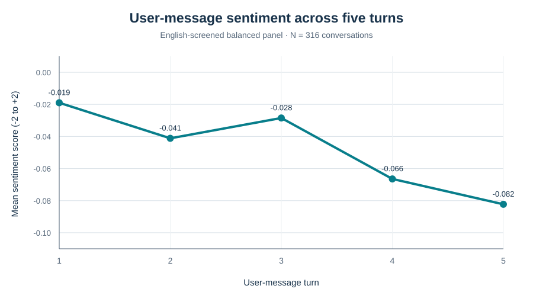

<!--
This website is public. Do not include private data, credentials, identifying
information, or material that you do not have permission to share.
-->

# Sentiment in Five-Turn WildChat Conversations

**Team:** Yunzhi (Wendy) Zhang, Macy Chen, Wangmeiqi (Maggie) Wei, Jeannette Harris, Jichu Duan

We studied whether the tone of user messages becomes more negative over the course of real ChatGPT conversations. In 316 English conversations with exactly five user messages, tone became slightly more negative from the first to the fifth message, but most conversations (88%) showed no change. Later short messages also contained more feedback and correction words, suggesting a possible shift toward refining requests and redirecting ChatGPT.

## Research Question and Motivation

**Research Question:** In multi-turn user–ChatGPT conversations, does the tone expressed in user messages become more negative as the conversation proceeds?

People increasingly use AI chatbots for writing, coding, and everyday tasks. When an answer misses the mark, users may repeat requests, correct the model, or express dissatisfaction. Measuring how user tone changes within a conversation can reveal points of friction in human–AI interaction.

Two terms matter throughout. **Tone** means the emotion expressed in the text of a message, such as thanks or criticism. It is not the same as the topic of the message (a request for a sad poem is not a negative message) or the user's private feelings or overall attitude toward AI. A **turn** is the position of a user message in the conversation, from 1 (first) to 5 (fifth).

## Data

- **Source:** [WildChat-1M](https://huggingface.co/datasets/allenai/WildChat-1M), a public collection of real user conversations with ChatGPT released by AllenAI (Zhao et al., 2024).
- **Unit of analysis:** One user message. Each conversation contributes five messages, one per turn.
- **Coverage:** We drew a reproducible random sample of 30,000 conversations (seed 42). Of these, 17,074 were labeled English, and 433 had exactly five non-empty user messages. After removing one duplicate, 432 conversations (2,160 user messages) remained. The sentiment analysis used 316 of these conversations (1,580 messages) after excluding conversations in which any message carried a non-English language label, one medically sensitive conversation, and two conversations with Russian or mixed-language turns despite English metadata.
- **Access and Ethics:** WildChat contains real user text that can be sensitive. We screened for possible API keys, excluded a medically sensitive conversation before sending text to an external model, and redacted obvious identifiers (emails, URLs, phone numbers) in text sent to Gemini. Individual message-level labels and coder files are kept private; this page reports only aggregate results. The sample covers English conversations with exactly five user messages, so it does not represent all WildChat users or conversation lengths.

## Methods

**Codebook and Human Validation:** We wrote a codebook that scores the tone of each user message on a five-point scale from −2 (clear anger or strong complaint) to +2 (clear praise or emphatic thanks), with 0 for neutral messages such as plain requests, pasted text, code, or role-play. For negative messages, coders also recorded whether the negativity targeted the AI or something else. Two team members independently scored a pilot sample of 46 messages from 10 randomly selected conversations. Before discussing disagreements, they agreed exactly on 87% of messages (Cohen's κ = 0.71; quadratic weighted κ = 0.76). They then resolved disagreements and finalized the codebook (version 4).

**LLM Scoring:** Gemini 3.5 Flash Lite scored all 1,580 messages using the finalized codebook. Each request contained one conversation's five user messages, labeled by turn, with instructions to score each message on its own. Assistant replies were not included.

**Comparisons:** We compared the mean score and the share of negative, neutral, and positive messages at each turn. To focus on change within the same conversation, we also calculated each conversation's turn-5 score minus its turn-1 score and estimated a 95% bootstrap confidence interval for the mean difference.

**Error Audit:** Team members blind-reviewed 140 Gemini labels: every message Gemini scored as non-neutral, plus five neutral messages per turn. This audit deliberately targets likely errors, so its error rates are not estimates for all messages.

**Message Length and Word Use:** Using all 432 cleaned conversations, we compared message length and word usage across turns. We repeated the word analysis for messages containing 50 words or fewer to examine the influence of message length. This exploratory analysis uses a broader sample than the sentiment analysis (316 conversations).

Code: data collection and cleaning in `notebooks/data_import_cleaning.ipynb`; scoring and turn comparisons in `scripts/llm_sentiment_analysis_v4.py`; length and word-use analysis in `notebooks/04_quantitative_findings.ipynb`.

## Findings

### Finding 1: Tone becomes slightly more negative, but most conversations do not change

| Turn | Mean score | Negative | Neutral | Positive |
|---:|---:|---:|---:|---:|
| 1 | −0.019 | 1.9% | 98.1% | 0.0% |
| 2 | −0.041 | 5.4% | 93.7% | 0.9% |
| 3 | −0.028 | 5.1% | 92.7% | 2.2% |
| 4 | −0.066 | 8.2% | 90.2% | 1.6% |
| 5 | −0.082 | 9.5% | 88.6% | 1.9% |

*Gemini scores on a −2 to +2 scale. N = 316 conversations at each turn.*

Almost all messages are neutral at every turn. The share of negative messages rises from 1.9% at turn 1 to 9.5% at turn 5. Within the same conversations, the average turn-5 minus turn-1 difference was −0.063 points (95% CI: −0.108 to −0.019). However, 278 of 316 conversations (88.0%) had no change in score; 29 (9.2%) were more negative at turn 5 and 9 (2.8%) were less negative. The decline is small and concentrated in a minority of conversations.

### Finding 2: Later messages shift from setting up a task to giving feedback

First messages are a different kind of text from later ones. The typical (median) user message is 21 words at turn 1 and about 15 words at turns 2–5, but the turn-1 mean is 278 words because some users paste long setups such as stories, instructions, or code. Very short messages (3 words or fewer) stay at about 7–9% at every turn.

Because long pasted texts contain almost any word, a simple comparison made correction words look less common at turn 5. We therefore compared word use only among messages of 50 words or fewer. In these messages, feedback and correction words become more common by turn 5:

| Word | Turn 1 | Turn 5 |
|---|---:|---:|
| not | 4.1% | 7.3% |
| again | 0.0% | 1.4% |
| wrong | 0.0% | 0.8% |
| continue | 0.0% | 2.8% |
| rewrite | 0.3% | 2.0% |

*Share of user messages of 50 words or fewer containing each word (N = 291 at turn 1, 356 at turn 5), from all 432 cleaned conversations.*

By turn 5, users are reacting to ChatGPT's earlier answers by correcting and redirecting it. This may explain part of the more negative tone in later turns: some of it may reflect feedback rather than frustration. The counts are small (for example, "wrong" appears in about 3 turn-5 messages), so this pattern is suggestive rather than conclusive.

## Interpretation and Limitations

- **Strongest Claim Supported:** In this sample of English five-turn conversations, the tone of user messages became slightly more negative on average by the fifth message, driven by a minority of conversations, while later messages contained more feedback and correction language.
- **Claim Not Supported:** These results do not show that users become frustrated with or dislike AI as conversations go on. The scores measure the tone of message text, not users' attitudes, satisfaction, or emotions outside the text, and most conversations showed no change at all.
- **Important Limitations:**
  - **Measurement Error.** In the targeted audit, Gemini's exact agreement with human reviewers was 70.7% (99 of 140), and in 33 of 41 score disagreements Gemini was more negative than the humans. Audit errors were also more common at later turns (2 of 11 reviewed messages at turn 1 versus 17 of 41 at turn 5), so part of the measured decline may reflect model error rather than a change in user tone. The perfect match on the 46-message pilot should be read alongside these results.
  - **Missing Context.** Messages were scored without the assistant's replies, so short messages such as "No" or "again" can be misread.
  - **Sample Restrictions.** Only English conversations with exactly five user messages were included. Users who became frustrated and left early are excluded. Automatic language labels also removed some conversations with short English messages (for example, "continue" was labeled French), and some users contributed more than one conversation.
  - **Non-Human Users.** Some WildChat "users" appear to be automated programs; the longest first message (20,246 words) is an AI-agent prompt rather than human writing.
  - **Pasted Text.** Turn-1 messages often include long pasted text, so comparisons between first and later turns must account for message length.
- **Social-Science Implications:** Changes in conversational tone are small and uneven, and much of what looks like negativity may be ordinary feedback as users work with a chatbot toward a goal. Studies of human–AI interaction should separate expressed tone from attitudes, account for message length and conversation structure, and validate automated sentiment measures against human judgment before concluding.

## Reproducibility

- **Repository:** [Add the link to the project repository.]
- **Environment:** Run `uv sync --frozen` from the repository folder.
- **Run order:**
  1. `notebooks/data_import_cleaning.ipynb`: downloads the sample from Hugging Face and creates `data/wildchat_cleaned_exactly5.json`.
  2. `scripts/llm_sentiment_analysis_v4.py --validation-only`: creates and scores the validation sample (requires a local `GEMINI_API_KEY`; never commit the key).
  3. `scripts/llm_sentiment_analysis_v4.py --all --validation-approved`: scores all eligible messages and produces turn summaries and the figure.
  4. `notebooks/04_quantitative_findings.ipynb`: message length and word-use analysis.
- **Data access:** WildChat-1M is publicly available on Hugging Face. The cleaned analysis file is included in the
